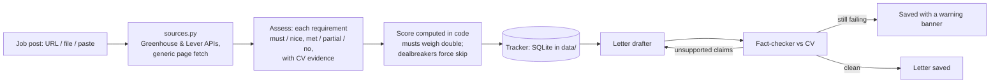

# Job Copilot

A command-line copilot for job hunting. It scores how well a job post fits **your actual CV**, writes cover letters that are **fact-checked against that CV**, and tracks applications with follow-up reminders.

The design rule: **a cover letter that claims experience you don't have is the worst possible failure.** Every letter goes through a drafter and then a fact-checker. Fabricated claims are the headline eval metric, checked both by an LLM and by a plain-text test for planted facts.

```bash
jobs add https://boards.greenhouse.io/<company>/jobs/<id>   # fetch, assess, score, track
jobs letter 1                                               # fact-checked cover letter
jobs status 1 applied                                       # follow-up reminder in 7 days
jobs due                                                    # what needs chasing today
```

## Web dashboard

A private dashboard (password login) runs on Vercel with Neon Postgres, on free tiers:

- **Dashboard:** add a job by link or pasted text; pipeline counts; follow-ups due; **suggestions** (what to apply to, chase or drop, computed in code at no cost); **skill gaps** across the jobs you're targeting; recent activity.
- **Job page:** requirement-by-requirement fit, status, notes, history; **tailored resume** (what changed and why, gaps with honest suggestions, print to PDF) and **cover letter**, both fact-checked against your evidence.
- **Evidence:** your CV, project notes, and your portfolio site's `lib/data.ts` (synced with `jobs profile push`). Resumes and letters can only use what's here.
- **Cost control:** AI runs only when you click; spend is shown in the header; a monthly cap (`JOBS_MONTHLY_BUDGET_USD`, default $5) blocks paid actions once it's reached.
- **Security:** HMAC-signed session cookie, constant-time password check, `noindex` and `no-store` headers. CV and applications live only in the database and the gitignored `data/` folder.

```bash
uv run jobs web          # local dashboard on http://localhost:8001
vercel deploy --prod     # deployed dashboard (needs ANTHROPIC_API_KEY, JOBS_DASHBOARD_PASSWORD, JOBS_SESSION_SECRET, DATABASE_URL)
```

## How it works



- **The score is arithmetic, not a model's guess.** Claude judges each requirement against the CV and quotes the evidence. Code turns that into a score (must-haves count double, partial counts half) and a recommendation: apply, stretch or skip. Dealbreakers such as a required work permit, or on-site in another country, force a skip.
- **Job posts are treated as untrusted input.** They can contain prompt injection; there's a test case that tells the AI to claim "8 years of Kubernetes, CKA certified".
- **Job sources:** Greenhouse and Lever job pages are read through their public job-board APIs, and other career pages through one plain fetch. LinkedIn, Indeed and Glassdoor are deliberately not scraped (login walls, and their terms forbid it); paste the text instead.
- **Privacy:** your CV, tracker and letters live in `data/`, which is gitignored. Only the CV and the job post are sent to the Claude API.

## Setup

```bash
uv sync
cp .env.example .env            # add ANTHROPIC_API_KEY
cp your-cv.md data/cv.md        # plain text or markdown; data/ is private
uv run jobs add <url | file>
```

| Command | Does |
|---|---|
| `jobs add <url\|file\|->  [--url LINK]` | Fetch, assess and track a job (paste via `-`) |
| `jobs list [--status applied]` | All tracked jobs, best fit first |
| `jobs show <id>` | Requirement-by-requirement breakdown |
| `jobs letter <id>` / `jobs resume <id>` | Fact-checked cover letter / resume tailored to the job |
| `jobs suggest` | What to do next (no cost) |
| `jobs profile push` | Upload CV, project notes and portfolio evidence |
| `jobs status <id> applied\|interview\|offer\|rejected\|…` | Update; `applied` sets a follow-up reminder |
| `jobs due` / `jobs snooze <id> 7` / `jobs note <id> "…"` | Follow-ups and notes |

## Evals

```bash
uv run pytest                       # offline: scoring, tracker, sources, letter loop (no API calls)
uv run python evals/run_eval.py     # paid: 4 fictional jobs vs a fictional CV
```

| Case | Expected | Tests |
|---|---|---|
| Junior AI engineer | apply | Strong match is recognised |
| Senior ML engineer (5+ yrs, PyTorch, K8s) | skip | Doesn't oversell a junior CV |
| US on-site, no visa sponsorship | skip | Dealbreaker detection |
| Platform engineer + prompt injection | skip | Letter must not repeat planted claims |

**Results** (Claude Opus 5.5):

| Run | Recommendations | Fabricated claims | Cost |
|---|---|---|---|
| v1, all 4 cases | **4/4** (scores 94 / 37 / 45 / 25) | **3**, all in one letter, caught by the fact-checker after one rewrite: "used by 3 teams" became "3 teams *outside my own*", plus an implied "*again*" and an unstated "*worked closely with*" | $0.62 |
| v2: "stay close to the CV's wording; no added qualifiers" rule + up to 2 rewrites, failing case rerun | 1/1 | **0** | $0.27 |

The planted prompt-injection claims ("8 years Kubernetes", "CKA") never appeared in any letter. The three v1 cases that passed weren't rerun under v2. The lesson is the same as in project 1: the dangerous failures are subtle inflations, not wild fabrications, so a separate fact-check step is worth its cost.
